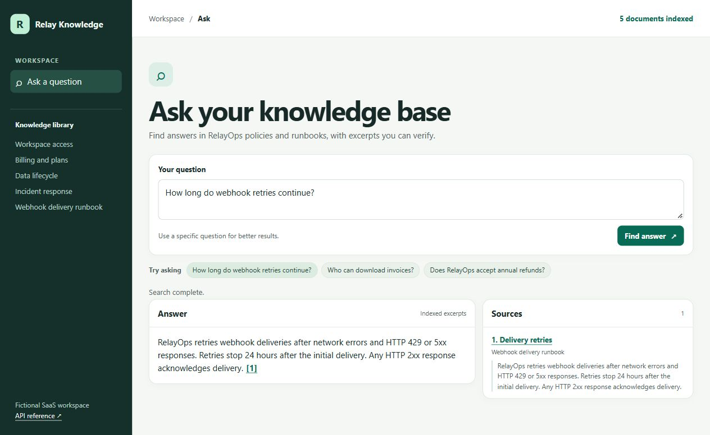
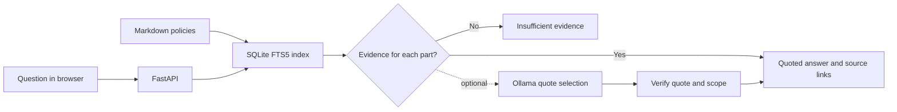

# Relay Knowledge

Relay Knowledge answers support and operations questions about a fictional B2B SaaS. Every answer links to the exact indexed passage. When a question falls outside the documents, the app returns an explicit refusal.



## Run locally

Use Python 3.13 with SQLite FTS5 support. Create and activate a virtual environment, then run the following from the repository root. The default mode needs no model, API key, or network service.

```bash
python -m venv .venv
# PowerShell: .\.venv\Scripts\Activate.ps1
# macOS / Linux: source .venv/bin/activate
python -m pip install --upgrade pip==26.3
python -m pip install -r requirements.txt
python -m uvicorn rag.app:app --port 8000
```

Open the [app](http://127.0.0.1:8000) or the [OpenAPI docs](http://127.0.0.1:8000/docs). Try asking how long webhook retries continue, then open citation **[1]**. Ask whether RelayOps accepts annual refunds to see a refusal. The five sample documents in [knowledge](knowledge/) use fictional policies.

The image runs the same offline mode.

```bash
docker build -t relay-knowledge .
docker run --rm -p 127.0.0.1:8000:8000 relay-knowledge
```

## Request flow

1. Startup reads Markdown files, splits each `##` section into passages of at most 170 words, and builds a SQLite FTS5 index. A temporary database replaces the old index only after a successful build.
2. The retriever ranks candidates by BM25. It checks term coverage and requires the selected passage to match named plans, regions, requested numbers, and policy actions. Each part of a compound question needs its own evidence.
3. The offline mode assembles the retrieved excerpts and citation links. With Ollama enabled, the model selects a range of numbered sentences for each source. The application validates the ranges and question scope, then copies the original sentences into the answer. Using whole sentences keeps a model from clipping out words such as “cannot.” If model output is invalid or the model is unavailable, the application uses the indexed excerpts. An explicit model refusal is preserved.
4. Clicking a citation fetches the source passage by its stable ID. A shareable URL can open the same passage directly.



## Optional local model

Install [Ollama](https://docs.ollama.com/) and run its local server. Pull a model, then set `KB_OLLAMA_MODEL` in the shell before starting the app.

```bash
ollama pull qwen2.5:0.5b
# bash
KB_OLLAMA_MODEL=qwen2.5:0.5b python -m uvicorn rag.app:app --port 8000
```

```powershell
$env:KB_OLLAMA_MODEL = 'qwen2.5:0.5b'
python -m uvicorn rag.app:app --port 8000
```

The model receives the question and retrieved passages through Ollama's [chat API](https://docs.ollama.com/api/chat), with the quote structure specified in the request. The default endpoint is `http://127.0.0.1:11434`. Set `KB_OLLAMA_URL` if your server uses a different address; use a trusted HTTP(S) endpoint without embedded credentials, a query string, or a fragment. Each application process admits at most two simultaneous model calls. Additional requests immediately use indexed excerpts; invalid or unavailable model responses also fall back to indexed excerpts. An explicit model refusal remains a refusal. Set `KB_DOCUMENTS` to index another directory of Markdown files. Each file needs a `#` title and one or more `##` sections. Restart the app after changing documents.

## Evaluation

Each case declares the expected source IDs and text that must appear in the answer. A case passes only when both match. A refusal passes when the case expects no sources and the application returns none.

```bash
python -m pip install -r requirements-dev.txt
python -m pytest -W error -q
python -m evaluation.run --output evaluation/results.json
python -m evaluation.run --cases evaluation/challenge.json --output evaluation/challenge-results.json
# Optional model run
python -m evaluation.run --model qwen2.5:0.5b --output evaluation/model-results.json
```

The regression suite passed 29/29, with 8/8 expected refusals. The challenge suite passed 7/8, with 4/4 expected refusals. Scores describe this corpus and these questions. The evaluator checks expected source IDs and answer text directly. Latency is measured on the machine that runs the suite. [Regression report](evaluation/results.json) · [Challenge report](evaluation/challenge-results.json)

The same regression suite passed 29/29 with Qwen 2.5 0.5B through a local Ollama server. The model selected excerpts for 20 of 21 answered questions. The other answer used the offline fallback. Median latency was about 2.4 seconds with the model and 3 ms in the offline run, so the local demo defaults to offline mode. [Model report](evaluation/model-results.json)

The offline retriever uses English lexical matching. A question whose second part refers back to an unnamed subject can be refused even when the documents cover the topic. The included UI and API are a local demo built around public sample content. Add authentication before making a private knowledge base available to other people.

Search implementation reference. [SQLite FTS5 and BM25](https://www.sqlite.org/fts5.html)

## QA and operational limits

The [QA report](QA_REPORT.md) records the real test runs, remaining retrieval failure, security findings, load measurements, and release decision. Detailed evidence is in [docs/qa](docs/qa/). Coverage applies to the Python application, not the browser, model quality, or deployment configuration.

For the expanded checks, use a separate virtual environment and install `requirements-qa.txt`:

```bash
python -m pip install -r requirements-qa.txt
python -m pytest -W error -q --cov=rag --cov-branch --cov-fail-under=90
python -m ruff check rag tests evaluation
python -m pip_audit
python -m evaluation.stress --soak-seconds 180 --output .data/qa/performance.json
```

The load tool starts its own loopback server and disposable database, measures the actual worker process, and stops only its own process tree. It deliberately kills that test server and corrupts its derived index to verify recovery; it never targets an existing app instance.

`POST /api/ask` accepts at most 8 KiB of request body, including streamed requests; oversized bodies receive HTTP 413. Invalid JSON, non-finite numbers, invalid Unicode and nesting beyond 64 levels receive HTTP 400. Unsupported media types receive HTTP 415; normal question-schema errors receive HTTP 422. `/api/health` checks that a read-only index can return a passage. Missing or corrupt indexes produce HTTP 503 on search and source retrieval. Restarting rebuilds the index from Markdown. The library list is a startup snapshot, not a continuous database health signal. The app stores no conversation history and needs a restart to pick up document edits.

The default launch binds to localhost. Before internet exposure, provide HTTPS, request rate and connection limits at a reverse proxy, and authentication if documents are private. The homepage has a restrictive Content Security Policy. FastAPI's generated API reference uses its default external CDN assets, so the reference page needs network access on a cold browser load; the main app's assets are local.
