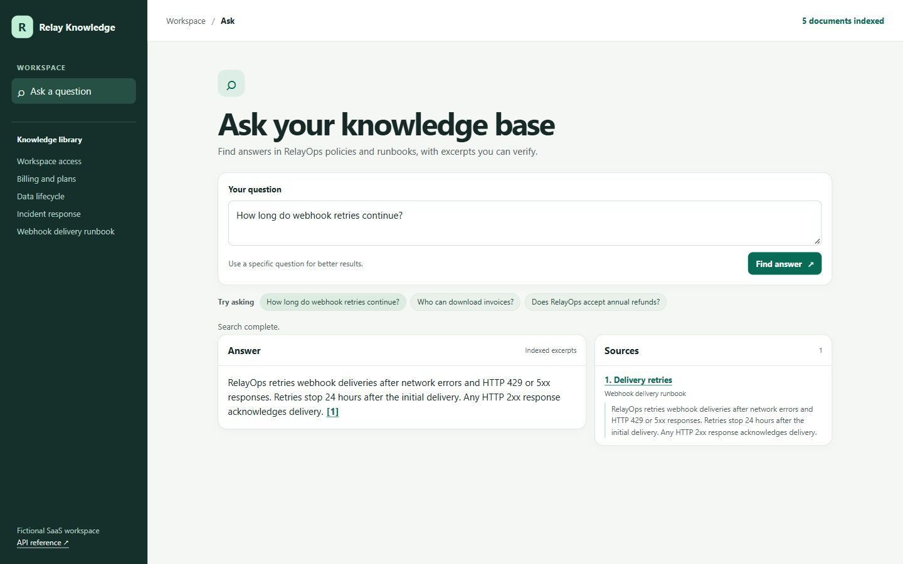
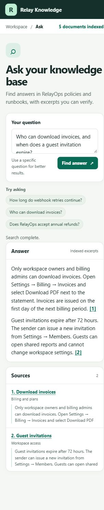

# Browser checks — 2026-11-22

Executed against a real Uvicorn server at `127.0.0.1:8095` using an isolated browser automation session. No fake API responses were injected into the browser. The server used a separate `.data/qa/ui-index.db`; only this test server was stopped during the outage scenario.

These are executed browser scenarios, not a Playwright test suite installed in the repository. To repeat them, start an isolated local instance and perform the actions below. Screenshots capture actual results. This is one browser engine, not cross-browser certification.

| # | Action | Observed result |
|---|---|---|
| 1 | Load `/` | Heading, labelled question field, five library titles and indexed-document count rendered. |
| 2 | Click webhook example | Answer contains 24 hours and one source. |
| 3 | Click invoice example | Answer identifies owners and billing admins. |
| 4 | Click refund example | Insufficient-evidence answer; source panel hidden. |
| 5 | Submit `Who can download invoices, and when does a guest invitation expire?` | Two independently labelled citations and source cards. |
| 6 | Click inline `[1]` | Source dialog opens and exact quote is highlighted with `mark`. |
| 7 | Click source-card link | Same source dialog opens. |
| 8 | Click Close source | Dialog closes. |
| 9 | Press Escape in dialog | Dialog closes and focus returns to the invoking citation link. |
| 10 | Navigate directly to `/?source=webhooks%2Fdelivery-retries%2F1` | Correct passage opens without submitting a question. |
| 11 | Navigate to a missing source ID | Dialog displays `Could not load the source. Try again.` and can be closed. |
| 12 | Submit `ab` | Custom minimum-length message appears and the question field receives focus. |
| 13 | Submit an empty field | Native required-field validity rejects submission. |
| 14 | Stop this test server and submit an example | Fetch fails; readable error appears and submit button is enabled again. |
| 15 | Restart this server and retry the existing question | Correct answer returns without reloading the page. |
| 16 | Follow API reference link | Swagger UI loads and lists the four API operations. |
| 17 | Follow Ask a question navigation | Main form renders again. |
| 18 | Submit `` | Refusal; zero injected images in the answer. |
| 19 | Inspect at 320×740, 768×900 and 1440×900 | No horizontal document overflow; form, examples and answer remain usable. Desktop/tablet/mobile screenshots inspected. |
| 20 | Inspect accessible roles and keyboard behaviour | Textarea has a label; heading hierarchy, live status and labelled dialog are exposed; dialog receives and restores focus. |

20/20 scenarios passed. The final page's captured error/warning log was empty. No automated WCAG/axe certification or screen-reader-device testing was performed. Mobile dimensions were browser viewport overrides, not physical device tests. The temporary viewport override was reset afterwards.

